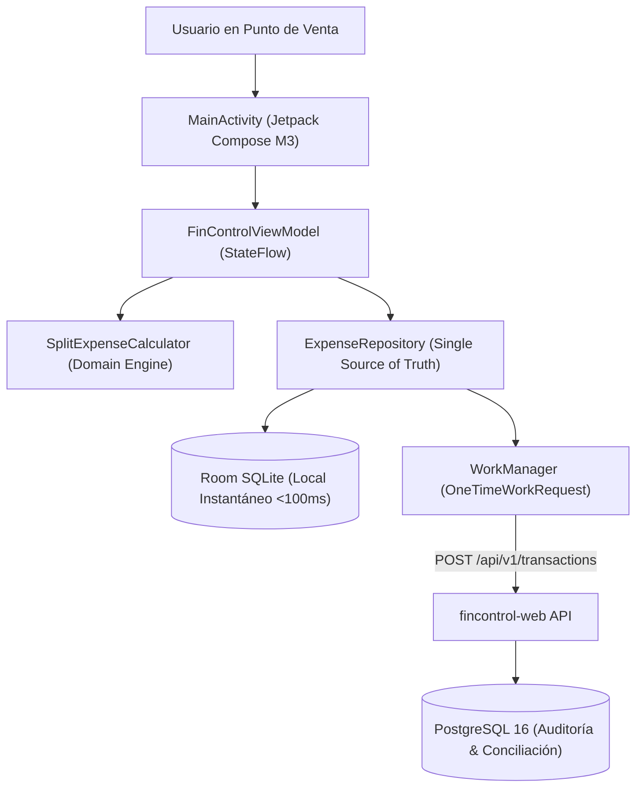

# Arquitectura Móvil — FinControl Android (Offline-First & Captura < 5s)

## 1. Propósito del Componente Móvil
Eliminar la fricción de entrada en el punto de venta (compras en efectivo, gastos informales sin NIT/factura `RN-03`, y cenas o supermercados compartidos `RN-01`) garantizando que registrar un gasto tome **menos de 5 segundos**.

## 2. Capas de la Arquitectura (Clean Architecture + MVVM)
- **`domain/` (`SplitExpenseCalculator.kt`):**
  - Motor aritmético con `BigDecimal` (`RoundingMode.HALF_UP`) para desglose exacto entre `personalAmountGtq` (afecta el presupuesto 50/30/20) y `receivableAmountGtq` (activo circulante por cobrar).
  - Clasificador predictivo de comercios frecuentes (`La Torre`, `Texaco`, `San Martín`, `Farmacia Galeno`).
  - Evaluador del semáforo mensual (`GREEN` < 80%, `YELLOW` 80%-100%, `RED` > 100%).
  - Cálculo dinámico de cuenta regresiva Totalero (`calculateTotaleroCountdown`) para fechas de corte y pago de contado a tasa 0%.
- **`data/local/` (`LocalExpenseDatabase.kt`):**
  - Persistencia **Offline-First** con Room SQLite. El usuario guarda el gasto en milisegundos aun sin señal celular en parqueos o sótanos comerciales.
- **`data/repository/` (`ExpenseRepository.kt`):**
  - Orquestador de persistencia reactiva que emite flujos `Flow<List<LocalExpenseEntity>>` hacia la UI y despacha tareas diferidas con `WorkManager`.
- **`data/sync/` (`ExpenseSyncWorker.kt`):**
  - Sincronización en segundo plano mediante `WorkManager` y `Retrofit` hacia el endpoint unificado `POST /api/v1/transactions` de `fincontrol-web`, marcando el registro como `PENDING_STATEMENT_MATCH` para evitar duplicidad cuando se cargue el PDF del estado de cuenta bancario.
- **`ui/` (`MainActivity.kt` & `FinControlViewModel.kt`):**
  - Interfaz en **Jetpack Compose (Material 3)**:
    - Teclado numérico directo al abrir.
    - Mini Dashboard Financiero (Liquidez, Semáforo 50/30/20, Alerta Totalero).
    - Lista de últimos 5 movimientos con gestos de deslizamiento (*Swipe-to-Dismiss*) y modal de edición rápida (`RN-04`).
    - Selector de fecha emergente y captura opcional de ticket sin bloqueo (`RN-03`).
