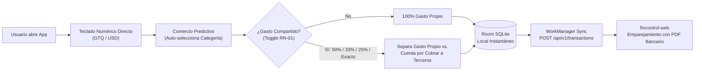

# Arquitectura Móvil — FinControl Android (Offline-First & Captura < 5s)

## 1. Propósito del Componente Móvil
Eliminar la fricción de entrada en el punto de venta (compras en efectivo, gastos informales sin NIT/factura `RN-03`, y cenas o supermercados compartidos `RN-01`) garantizando que registrar un gasto tome **menos de 5 segundos**.

## 2. Capas de la Arquitectura (Clean Architecture + MVVM)
- **`domain/` (`SplitExpenseCalculator.kt`):**
  - Motor aritmético con `BigDecimal` (`RoundingMode.HALF_UP`) para desglose exacto entre `personalAmountGtq` (afecta el presupuesto 50/30/20) y `receivableAmountGtq` (activo circulante por cobrar).
  - Clasificador predictivo de comercios frecuentes (`La Torre`, `Texaco`, `San Martín`, `Farmacia Galeno`).
  - Evaluador del semáforo mensual (`GREEN` < 80%, `YELLOW` 80%-100%, `RED` > 100%).
- **`data/local/` (`LocalExpenseDatabase.kt`):**
  - Persistencia **Offline-First** con Room SQLite. El usuario guarda el gasto en milisegundos aun sin señal celular en parqueos o sótanos comerciales.
- **`data/sync/` (`ExpenseSyncWorker.kt`):**
  - Sincronización en segundo plano mediante `WorkManager` y `Retrofit` hacia el endpoint unificado `POST /api/v1/transactions` de `fincontrol-web`, marcando el registro como `PENDING_STATEMENT_MATCH` para evitar duplicidad cuando se cargue el PDF del estado de cuenta bancario.
- **`ui/` (`MainActivity.kt`):**
  - Interfaz en **Jetpack Compose (Material 3)** que integra el Mini Dashboard Financiero (Liquidez, Semáforo 50/30/20, Alerta de Corte/Pago de Contado de Tarjeta) y el formulario de Captura Express.
